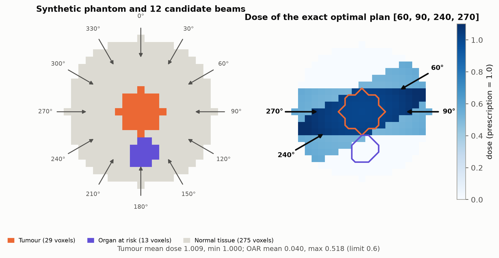
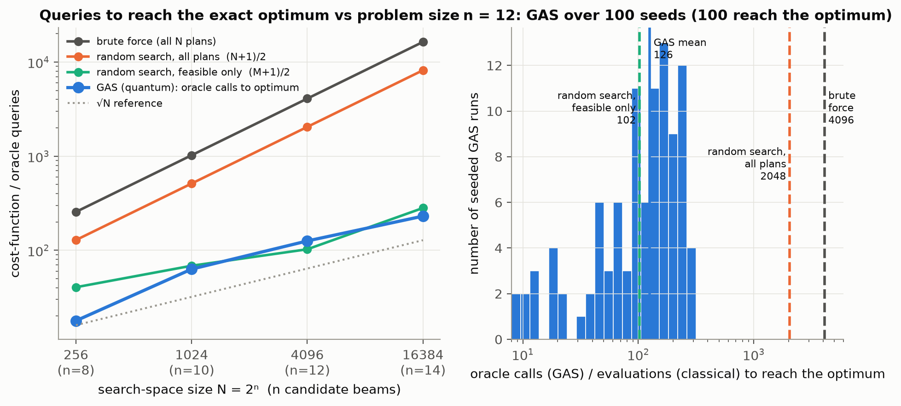

# Quantum Grover Adaptive Search for Radiotherapy Beam-Angle Selection under a Beam Limit

**Qiskit Fall Fest 2026, The Quantum Optimization Challenge · Domain: Healthcare**

A radiotherapy plan has to decide **which gantry angles deliver radiation beams**. More beams cover the tumour better
but cost treatment time and irradiate more healthy tissue, and some angles pass straight through a critical organ.
We choose up to **4 of 12 candidate beams** on a synthetic 2-D phantom. The goals are to cover a tumour, spare an organ
at risk (OAR) and spare normal tissue, under a hard OAR maximum-dose limit. We solve it with **Grover Adaptive Search
(GAS)** written from scratch in Qiskit and check every result against an exact classical answer.

| | |
|---|---|
| Report | [`report/Radiotherapy_GAS_Report.docx`](report/Radiotherapy_GAS_Report.docx) |
| Problem statement | [`PROBLEM_STATEMENT.md`](PROBLEM_STATEMENT.md) |
| All numbers | [`results/results.json`](results/results.json) (figures in [`results/`](results)) |

## Results at a glance (full run, all seeds fixed)

| | |
|---|---|
| Search space | N = 2¹² = 4096 plans → 794 satisfy the beam limit → **204 feasible** (beam limit + OAR max dose) |
| Exact optimum (brute force) | beams **{60°, 90°, 240°, 270°}**, F = 0.03803, unique (runner-up gap 1.7e-03) |
| GAS success rate | **100%** of 100 seeded runs return the exact optimum |
| GAS oracle calls to the optimum | mean **126**, median 120 (√N = 64) |
| Classical unstructured search | (N+1)/2 = 2048.5 evaluations → GAS uses **16× fewer queries** |
| Gap vs problem size | random ÷ GAS = 7× → 8× → 16× → 36× for n = 8, 10, 12, 14 beams; GAS queries grow ≈ N^0.47 over n = 10–14 (N^0.60 over all four sizes; unstructured search: N¹) |
| Structure-aware classical | at n = 12: greedy 43 evaluations, simulated annealing 62 (98% success), random search over only the 204 feasible plans 102.5. **These beat GAS at this size, and we say so.** Against feasible-only random search the result is mixed across sizes (GAS fewer at n = 8, 10, 14; more at n = 12). |
| Grover check | Aer statevector vs sin²((2r+1)θ): max error 3e-14 |
| Circuit | 12 qubits, 0 ancillas; one iteration = 4,536 CX after transpiling (truth-table oracle ≈ 2ⁿ gates) |

<p align="center"></p>
<p align="center"></p>

## Setup and run (Python ≥ 3.10)

```bash
git clone https://github.com/DuaanXahmed/Quantum-Radiotherapy-Beam-Selection.git
cd Quantum-Radiotherapy-Beam-Selection
python3 -m venv .venv && source .venv/bin/activate      # Windows: .venv\Scripts\activate
pip install -r requirements.txt

pytest -q                              # 9 tests, ~5 s
python run_experiments.py --quick      # < 60 s smoke run + printed GAS walk-through (results/results_quick.json)
python run_experiments.py              # full run, ~4-5 min -> results/results.json
python plots.py                        # 6 figures -> results/fig*.png
python make_report.py                  # report/Radiotherapy_GAS_Report.docx (numbers read from results.json)
```

Tested with Python 3.12, Qiskit 2.6, Qiskit Aer 0.18, NumPy 2.5 on macOS.

## Repository layout

| File | What it does |
|---|---|
| `phantom.py` | Geometry (body, tumour, OAR, normal tissue), beam model, dose matrix `D[a, v]` |
| `plans.py` | Cost F(x), constraints C1/C2, little-endian encode/decode, exact enumeration, w_O sweep, Pareto front |
| `grover.py` | Truth-table phase oracle (`DiagonalGate`), diffuser, Grover circuit, **GAS**, statevector check, circuit stats |
| `baselines.py` | Brute force, random search, greedy, simulated annealing, NNLS lower bound |
| `run_experiments.py` | Runs everything and writes `results/results.json` (`--quick` for a < 60 s run) |
| `plots.py` | The 6 figures, from `results.json` |
| `make_report.py` | Builds the `.docx` report from `results.json` and the figures |
| `tests/test_core.py` | Feasible count, F vs manual calculation, bit order, oracle marks, Grover iteration vs theory, diffuser, seeded GAS = brute force |

## Method in one paragraph

Qubit *a* is beam *a*, so the basis state |i⟩ is the plan whose beams are the 1-bits of i (Qiskit little-endian).
The phase oracle **O_y** flips the sign of |x⟩ iff x is feasible (Σx ≤ 4 and OAR max dose ≤ 0.6) **and** F(x) < y. It is
built from a ±1 truth table with `DiagonalGate`. The diffuser is H·X·(multi-controlled Z)·X·H. GAS starts at a
random feasible plan with y = F(plan) and m = 1. In each round it picks r uniformly in [0, ⌈m⌉−1], runs r Grover
iterations on AerSimulator, measures **one shot**, and evaluates F classically. On improvement it sets y ← F and m ← 1;
otherwise m ← min(6/5·m, √N). Oracle calls (Grover iterations) and classical evaluations (measurements) are counted
separately.

## Design choices (recorded as the brief asked)

1. **OAR centre at (0.3, −5.7)** instead of exactly (0, −6). A left-right symmetric phantom gives every asymmetric
   plan a mirror twin with identical cost, so the optima at w_O = 0 and w_O = 5 tied. A 0.3-voxel offset makes every
   sweep optimum unique while keeping the OAR about 6 voxels below the tumour. The (1, −6) offset we also tried made
   the sweep trivial: two beams then missed the OAR completely.
2. **GAS stopping rule: ⌈log_λ √N⌉ + 2 consecutive failures** (25 for N = 4096), plus a budget of 30√N oracle calls.
   This is the number of failures the BBHT range m needs to grow from 1 to its √N cap. With the suggested 15 rounds,
   r never exceeds 15 and GAS usually stalls one step before the optimum (26% success vs 100%; see the ablation
   table in the report).
3. **Simulated annealing uses swap moves** (move a beam to an unused angle) as well as bit flips. With flips alone it
   gets trapped at the 4-beam limit (≈ 10–20% success), which would make the classical baseline unfairly weak.
4. **Brute force is a per-plan Python loop** so that its runtime is an honest single-plan-evaluation timing. Exact
   tables for analysis use vectorised NumPy.
5. **Scaling study** reuses the phantom with n equi-spaced angles (n = 8, 10, 12, 14) and k = 4. Trials: 60, 60, 100
   and 20 (n = 14 is the slowest to simulate).
6. **Seeds:** GAS 1000+i, simulated annealing 2000+i, scaling 3000+i, random search 7, transpiler 0.

## Limitations (also in the report, Section 6)

- The advantage is in **query count only**. There is no wall-clock speedup on a simulator, and none over structured
  solvers (branch-and-bound / MIQP) or over classical methods that use the feasible-set structure.
- The oracle is a **precomputed truth table**, which already evaluates every plan classically. A real oracle needs
  reversible arithmetic for dose, cost and constraints on error-corrected hardware. That overhead can erase a quadratic
  speedup (Babbush et al., PRX Quantum 2021).
- **12 qubits is brute-forceable.** Clinical planning uses about 36–180 angles, continuous intensities, 3-D anatomy and Monte-Carlo
  dose.
- The phantom and dose model are simplified (2-D, no scatter, no penumbra). Weights and thresholds are tuned on one instance.
- Ideal, noise-free simulator. **Not clinical software.**

## Credits (algorithms cited; all code written by the team, no `qiskit_optimization` / GroverOptimizer or tutorial code)

- L. K. Grover (1996), *A fast quantum mechanical algorithm for database search*, arXiv:quant-ph/9605043
- C. Dürr & P. Høyer (1996), *A quantum algorithm for finding the minimum*, arXiv:quant-ph/9607014
- M. Boyer, G. Brassard, P. Høyer, A. Tapp (1998), *Tight bounds on quantum searching*, Fortschritte der Physik 46
- A. Gilliam, S. Woerner, C. Gonciulea (2021), *Grover Adaptive Search for Constrained Polynomial Binary Optimization*, Quantum 5, 428
- R. Babbush et al. (2021), *Focus beyond quadratic speedups for error-corrected quantum advantage*, PRX Quantum 2, 010103
- T. Bortfeld & W. Schlegel (1993), *Optimization of beam orientations in radiation therapy*, Phys. Med. Biol. 38, 291
